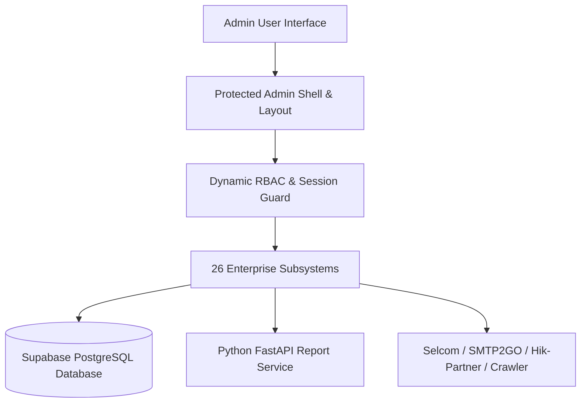
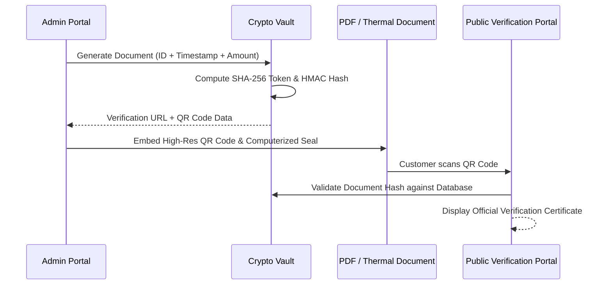

# QuardCube Labs — Comprehensive Admin Dashboard System Audit & Inventory

> **Document Version:** 1.0.0  
> **Target Environment:** Production / Enterprise ERP  
> **Generated:** October 2026  
> **System Scope:** `app/admin` & Protected Operational Subsystems  

---

## 1. Executive Summary & Tech Architecture

The **QuardCube Labs Admin Dashboard** is an enterprise-grade ERP, commercial operations, surveillance, and business intelligence platform built on Next.js 16 (App Router) and React 19. It provides an end-to-end administration suite tailored for IT, cybersecurity, surveillance solutions, corporate hardware retail, and technical services in Tanzania and East Africa.



### Core Technology Stack

| Layer | Technologies & Libraries |
| :--- | :--- |
| **Framework & Runtime** | [Next.js 16](https://nextjs.org/) (App Router), [React 19](https://react.dev/), TypeScript 5, Node.js |
| **Styling & UI Kit** | Vanilla Tailwind CSS v3.4, Radix UI Primitives, Lucide Icons, Framer Motion |
| **Database & ORM** | [Supabase](https://supabase.com/) (PostgreSQL), Drizzle ORM, Direct SQL schemas with RLS |
| **Charts & Telemetry** | [Recharts 2.15](https://recharts.org/) (Interactive Bar, Line, Area, Doughnut, Composed Charts) |
| **Document Generation** | `react-to-print`, `exceljs`, `docx`, `qrcode`, dedicated **FastAPI Python Microservice** |
| **Payments & Integrations** | Selcom Payment Gateway (`selcom-apigw-client`), Vodacom M-Pesa, PayPal, Stripe |
| **Communications** | Nodemailer (SMTP2GO), Meta WhatsApp Cloud Webhooks, System Notification Bus |

---

## 2. Shell, Navigation & Theme System

The admin dashboard operates within a unified protected shell (`app/admin/(protected)/layout.tsx`) featuring:

- **Curved Inner Viewport:** Pinned desktop canvas with rounded top-left junction (`rounded-tl-2xl`) against the navbar and sidebar.
- **Dual Theme System:** Seamless toggle between **Dark Mode** (`#0d0d12` canvas with `#0a1033` card containers) and **Light Mode** (pure white cards with crisp slate borders), persistent via `AdminThemeContext`.
- **Signature QuardCube Aesthetics:** Ambient cyan/navy glow orbs and subtle geometric dot-grid overlays (`pattern-grid`, `pattern-grid-dark`).
- **Responsive Mini-Sidebar:**
  - Expanded mode (64 units wide) with full company branding (`/sidebar-logo.png`).
  - Collapsed mini mode (20 units wide) with high-density icon layout (`/turquoise.png`).
  - Mobile slide-out drawer with gesture-friendly backdrop dismiss.
- **Top Admin Navbar:**
  - **Universal Global Search:** Real-time fuzzy query across customer records, orders, products, invoices, and suppliers (`lib/search-actions.ts`).
  - **Live Notification Center:** Persistent unread alerts categorized into *Orders*, *Inventory*, *Finance*, and *System* updates with one-click dismiss and mark-as-read.
  - **Fullscreen Canvas Toggle:** One-touch browser fullscreen switch for operations monitoring.
  - **Active Session Profile:** Shows administrator avatar, role badge, session email, and instant sign-out.

---

## 3. Security, Authentication & Role-Based Access Control (RBAC)

The administrative system is governed by a strict Zero-Trust RBAC framework configured in `lib/rbac-rules.ts` and `lib/role-constants.ts`.

### 3.1 Permission Structure
- **48 Granular Permissions** grouped into **8 Functional Domains**:
  1. *Dashboard & Executive Analytics* (`dashboard:view`, `analytics:view`)
  2. *Sales & Commercial Operations* (`orders:view`, `orders:manage`, `invoices:view`, `invoices:manage`, `proforma:view`, `proforma:manage`, `receipts:view`, `receipts:manage`, `quotations:view`, `quotations:manage`)
  3. *Inventory & Warehousing* (`inventory:view`, `inventory:manage`)
  4. *Procurement, Suppliers & Expenses* (`purchases:view`, `purchases:manage`, `suppliers:view`, `suppliers:manage`, `expenses:view`, `expenses:manage`)
  5. *Catalogs, Services & Projects* (`products:view`, `products:manage`, `services:view`, `services:manage`, `projects:view`, `projects:manage`)
  6. *Financial Reports & Bid Bonds* (`reports:view`, `reports:generate`, `bonds:view`, `bonds:manage`)
  7. *Human Resources & Branches* (`branches:view`, `branches:manage`, `staff:view`, `staff:manage`, `positions:view`, `positions:manage`, `applications:view`, `applications:manage`)
  8. *Surveillance, Governance & Administration* (`cctv:view`, `cctv:manage`, `blogs:view`, `blogs:manage`, `users:view`, `users:manage`, `roles:view`, `roles:manage`, `settings:view`, `settings:manage`)

### 3.2 Pre-Configured System Roles

| Role ID | Role Name | Badge Color | Default Authority & Key Permissions |
| :--- | :--- | :--- | :--- |
| `owner_admin` | **Owner / Executive Admin** | `teal` | Root privileges. Full control over all 48 permissions and financial bypass. |
| `manager` | **Operations Manager** | `navy` | Operational management over sales, stock transfers, PO approvals, discounts, and staff view. |
| `accountant` | **Financial Controller** | `purple` | Invoicing, payments, vouchers, expense approvals, ledger audits, tax, and statements. |
| `stock_manager` | **Warehouse & Inventory Controller** | `amber` | SKU master, warehouse transfers, stock adjustments, vendor goods receipts. |
| `cashier` | **POS Cashier** | `emerald` | Frontline checkout, order lookup, and verified thermal receipt generation. |

### 3.3 Dynamic Access Guard
When an authenticated staff member navigates to a module for which their role lacks permission, the shell suppresses the view and displays an animated **Access Restricted / Permission Denied** screen with breadcrumb fallback to `/admin/dashboard`.

---

## 4. Comprehensive Subsystems & Routes Directory

Below is the complete inventory of all **26 functional subsystems** implemented across the admin portal:

```
app/admin/
├── (protected)/
│   ├── dashboard/                # 1. Executive Sales & Operations Overview
│   ├── analytics/                # 2. Cross-Module Deep Business Analytics
│   ├── orders/                   # 3. Store Orders, POS Checkouts & Fulfillment
│   ├── invoices/                 # 4. Commercial & Tax Invoices with Verification
│   ├── proforma-invoices/        # 5. Proforma Estimates & Quote-to-Invoice Conversion
│   ├── receipts/                 # 6. Thermal & A5 Sales Payment Receipts
│   ├── quotations/               # 7. Multi-Item Commercial Bidding Proposals
│   ├── inventory/                # 8. Real-Time Stock, Valuations & Movements
│   ├── purchases/                # 9. Procurement, POs & Goods Received Notes (GRN)
│   ├── suppliers/                # 10. Vendor Database, Ledgers & Contact Profiles
│   ├── expenses/                 # 11. Operational Expense Tracker & Petty Cash
│   ├── products/                 # 12. Item Master, Pricing, Barcodes & Feeds
│   ├── services/                 # 13. Technical & Engineering Service Offerings
│   ├── projects/                 # 14. Client Project Portfolio & Milestones
│   ├── positions/                # 15. Career Vacancies & Job Requirements
│   ├── applications/             # 16. Candidate Tracking & Interview Scheduler
│   ├── branches/                 # 17. Multi-Branch Network Across Tanzania
│   ├── staff/                    # 18. Staff Accounts, Security Credentials & Auth Sync
│   ├── roles/                    # 19. RBAC Permission Matrix & Custom Roles
│   ├── cctv/                     # 20. CCTV Surveillance Hub & Engineering Wizards
│   ├── bonds/                    # 21. Corporate Bonds & Treasury Exchange Crawler
│   ├── reports/                  # 22. Universal Multi-Format Report Engine
│   ├── settings/                 # 23. Global Business, Payment, SMTP & WhatsApp Setup
│   ├── help/                     # 24. Internal Help Desk, Tickets & Knowledge Base
│   ├── users/                    # 25. External Client & Customer Auth Profiles
│   └── blogs/                    # 26. CMS News, Articles & Technical Blog Posts
├── login/                        # Admin Portal Authentication
└── page.tsx                      # Root Router with Session Verification
```

---

## 5. Detailed Module Analysis

### 5.1 Executive Overview & Analytics
- **Dashboard (`/admin/dashboard`):**
  - Live KPIs: Total Orders, Active Customers, Pending Orders, Total Revenue with monthly percentage deltas.
  - Interactive Revenue Bar Chart: Filterable by *Today*, *This Week*, *This Month*, and *This Year*.
  - Profit and Loss tracking with dynamic revenue vs. cost trends.
  - Live activity ticker displaying real-time events across invoices, projects, and store orders.
- **Analytics (`/admin/analytics`):**
  - 1,350+ lines of analytical telemetry.
  - Doughnut distribution charts for order fulfillment (Completed, Processing, Cancelled).
  - Customer acquisition and active visitor trends.
  - Direct deep-links from analytical events straight to corresponding order or user records.

### 5.2 Commercial, Sales & Invoicing Pipeline
- **Orders Management (`/admin/orders`):**
  - Full order lifecycle: *Pending*, *Processing*, *Completed*, *Cancelled*.
  - Detail view routes (`/admin/orders/[id]` and `/admin/orders/view/[id]`).
  - Customer contact lookup, shipping address details, and line-item summaries.
- **Invoices (`/admin/invoices`):**
  - 1,600+ lines of enterprise invoice management.
  - Multi-item calculations: subtotal, VAT (18%), discount, and balances due.
  - Direct browser printing via `react-to-print` with custom print layout (`/admin/invoices/[id]/print`).
  - Stamped with **QuardCube Verified QR Code** and cryptographic verification token.
- **Proforma Invoices (`/admin/proforma-invoices`):**
  - Formal price estimates with customizable payment terms.
  - **One-Click Conversion:** Instantly convert an approved proforma directly into an active commercial invoice.
  - Multiple professional layout templates (`ProformaTemplateRenderer`).
- **Payment Receipts (`/admin/receipts`):**
  - Payment settlement recording linked to orders or commercial invoices.
  - **3 Supported Print Templates:**
    1. *Thermal 80mm* (Standard POS receipt rolls with computerized stamp).
    2. *Thermal 58mm* (Compact format for portable handheld thermal printers).
    3. *A5 Voucher* (Formal enterprise payment voucher).
- **Price Quotations (`/admin/quotations`):**
  - 2,000+ lines supporting both physical catalog products and professional technical services.
  - Auto-calculated unit costs, markups, taxes, and expiration dates.
  - One-click workflow to convert accepted quotations into customer orders.

### 5.3 Inventory, Procurement & Supply Chain
- **Stock & Warehousing (`/admin/inventory`):**
  - Multi-warehouse inventory visibility (e.g. *Central Hub — Kigamboni*).
  - Audit trail of stock movements: `IN`, `OUT`, `ADJUSTMENT`, `TRANSFER`.
  - Automated low-stock indicators and reorder alerts.
  - Total warehouse valuation calculated at cost and selling prices.
- **Purchase Orders (`/admin/purchases`):**
  - Vendor procurement orders with expected delivery tracking.
  - Automated generation of **Goods Received Notes (GRN)** upon shipment arrival, immediately adjusting inventory stock.
- **Suppliers Directory (`/admin/suppliers`):**
  - Comprehensive vendor profiles with TIN and VAT registration numbers.
  - Payment terms management (Net 15, Net 30, COD) and running accounts payable balances.
  - Supplier ledger history page (`/admin/suppliers/[id]`).
- **Business Expenses (`/admin/expenses`):**
  - Operational disbursement logging across 12 categories (*Software*, *Utilities*, *Logistics*, *Salaries*, etc.).
  - Billable/non-billable flag, payment references (Bank Transfer, M-Pesa, Card), and receipt upload attachments.
  - Expense details page (`/admin/expenses/[id]`).

### 5.4 Catalogs & Content Management
- **Store Catalog (`/admin/products`):**
  - Item master management with SKU, categories, prices, inventory levels, ratings, and swatch image carousels.
  - Dedicated product editor routes (`/admin/products/[id]/edit` and `/admin/products/edit/[id]`).
  - **Bulk Export & Feeds:** One-click Excel spreadsheet export, PDF catalog download, Google Merchant Feed endpoint (`/api/feeds/google-merchant`), and background removal API (`/api/remove-bg`).
- **Services Catalog (`/admin/services`):**
  - Catalog for IT, networking, CCTV, and cybersecurity engineering services.
  - Service descriptions, price brackets, feature checklists, and visual icons.
- **Client Projects (`/admin/projects`):**
  - Project portfolio management with technology stack tags, case studies, live demo links, and GitHub repositories.
  - Dedicated project detail view (`/admin/projects/[id]`).
- **Blogs CMS (`/admin/blogs`):**
  - Corporate news publishing with SEO meta tags, excerpt generator, categories, tags, and scheduled publishing.

### 5.5 Human Resources & Branch Infrastructure
- **Branches Network (`/admin/branches`):**
  - Covers all 31 administrative regions of Tanzania (Dar es Salaam, Arusha, Dodoma, Mwanza, Zanzibar, etc.).
  - Tracks branch manager, daily sales, local staff count, and inventory valuation.
  - Individual branch overview (`/admin/branches/[id]`).
- **Staff Directory (`/admin/staff`):**
  - Employee database with staff codes, assigned branches, and active roles.
  - **Administrative Super-Tools:** Direct password reset, toggle active/suspended status, and automatic batch synchronization with Supabase Auth (`syncAllStaffToAuth`).
  - Employee profile and audit page (`/admin/staff/[id]`).
- **Positions & Hiring (`/admin/positions` & `/admin/applications`):**
  - Job opening publisher with salary bands, department, experience requirements, and benefits.
  - Candidate applicant tracking system (ATS) with CV preview, LinkedIn links, status progression (*Pending*, *Shortlisted*, *Interview*, *Hired*, *Rejected*), and interview scheduling.

### 5.6 Specialized Hubs & Innovation Modules

#### A. CCTV Surveillance Management Hub (`/admin/cctv`)
A purpose-built engineering platform for planning, estimating, and deploying surveillance infrastructure:
1. **Site Survey Wizard:** Guides technicians through surveying client sites (building types, number of floors, internet speed, environment, camera count).
2. **Camera Location Mapping:** Specifies camera models (Turret, Bullet, PTZ), lens focal lengths (2.8mm, 4mm), resolutions (2MP, 4MP, 4K), and features (ColorVu, AcuSense, IR Night Vision).
3. **Storage & Bandwidth Calculator:** Calculates required NVR channels, incoming bandwidth (Mbps), and exact hard drive capacity (TB) based on camera count, resolution, H.265 compression, and retention days (e.g., 30 days).
4. **Cable & Power Budget Calculator:** Estimates total Cat6 cable runs (meters) and PoE switch power budgets (Watts) to prevent signal degradation.
5. **Pre-Configured CCTV Packages:** Quick bundles for residential, retail, and commercial setups.
6. **Hikvision SSO Bridge:** Direct access to Hikvision’s Hik-Partner Pro cloud portal.

#### B. Corporate Bonds & Treasury Markets (`/admin/bonds`)
A live financial telemetry and crawling system (`lib/bonds-crawler.ts`) monitoring corporate bonds and fixed-income assets:
- **Exchanges Covered:** Dar es Salaam Stock Exchange (DSE), Nairobi Securities Exchange (NSE), Johannesburg Stock Exchange (JSE), and London Stock Exchange (LSE).
- **Live Price Ticks:** Animated visual up/down price changes with real-time flash indicators.
- **Yield to Maturity (YTM):** Dynamic computation of coupon rates vs. secondary market yields.
- **Lot Size Calculator:** Computes unit prices, local currency conversions, and minimum lot investment values.
- **Bond Detail Page:** `/admin/bonds/[id]` for in-depth credit rating, prospectus, and issuer history.

#### C. Universal Report Engine (`/admin/reports` & `report_service`)
An enterprise-grade document compiler supporting 15 business report categories (Sales, Invoices, Expenses, Inventory, Customers, Financial, CCTV, IT Assets, Custom):
- **Document Architecture:** Modular sections including formal Cover Page, Document Control, Table of Contents, Executive Summary, Scorecard KPIs, Recharts Visuals, Data Tables, Methodology, Observations, Recommendations, and Official Audit Seal.
- **Dual Rendering Stack:**
  - Fast in-browser Next.js client engine (`lib/reports-actions.ts`).
  - Dedicated **Python FastAPI Microservice** (`report_service/main.py`) executing ReportLab and Docx generators for pixel-perfect PDF, DOCX, and XLSX rendering.

---

## 6. Document Verification & Anti-Fraud Security

To prevent forgery and ensure commercial integrity, all customer-facing documents generated by the dashboard (Invoices, Quotations, Proformas, Receipts, and Purchase Orders) utilize a cryptographic verification subsystem (`lib/document-verification.ts`):



- **Verification URL:** Resolves to `/verify?doc=<DOC_TYPE>&token=<HASH>`.
- **Public Trust Badges:** Verifies issuer name, company TIN/VAT, total amount, issue timestamp, and official computerized stamp.

---

## 7. System Settings & Enterprise Integrations (`/admin/settings`)

The settings console provides centralized control over six administrative sectors:

1. **General Business Preferences:** Company legal name, trade description, support email addresses, timezone (`Africa/Dar_es_Salaam`), and default currency (`TZS`).
2. **Appearance & Branding:** Dark/Light mode default, primary brand color (`#000080` Navy, `#40E0D0` Teal), corporate logo upload, and custom CSS overrides.
3. **Security & Governance:** Two-Factor Authentication (2FA) toggle, session timeout policies (30 mins), login attempt rate-limiting, and administrator credential management (change admin email and password with current password verification).
4. **Payment Gateways:**
   - **Selcom Gateway:** Live merchant checkout and webhook status endpoints.
   - **Vodacom M-Pesa:** Mobile money settlement integration.
   - **Stripe & PayPal:** International credit card processing.
5. **Email / SMTP Delivery:** Configuration for transactional email using SMTP2GO (`mail-eu.smtp2go.com`, port 2525), custom from-name, and built-in SMTP connection tester.
6. **Diagnostics & Testing Tools:**
   - **WhatsApp Integration Panel:** Live message preview and webhook test emitter (`whatsapp-test-panel.tsx`).
   - **Notification Tester:** Validates real-time broadcast alerts across connected staff sessions (`notification-tester.tsx`).
   - **Database Backup:** On-demand database export and snapshot download.

---

## 8. Summary Table of All Admin Routes

| Route | Subsystem Name | Key Permissions | Export / Print |
| :--- | :--- | :--- | :--- |
| `/admin` | Root Redirect | Authenticated | — |
| `/admin/login` | Authentication Portal | Public | — |
| `/admin/dashboard` | Executive Sales Overview | `dashboard:view` | Charts Telemetry |
| `/admin/analytics` | Business Analytics | `analytics:view` | Recharts Visuals |
| `/admin/orders` | Customer Orders & POS | `orders:view` / `orders:manage` | Printable Sheets |
| `/admin/orders/[id]` | Order Detail View | `orders:view` | Print Packing Slip |
| `/admin/invoices` | Commercial & Tax Invoices | `invoices:view` / `invoices:manage` | PDF, Thermal, QR |
| `/admin/invoices/[id]/print` | Invoice Dedicated Print View | `invoices:view` | Direct Browser Print |
| `/admin/proforma-invoices` | Proforma Invoices | `proforma:view` / `proforma:manage` | Multi-Template PDF |
| `/admin/receipts` | Payment Receipts | `receipts:view` / `receipts:manage` | 80mm, 58mm, A5 |
| `/admin/quotations` | Price Quotations | `quotations:view` / `quotations:manage` | PDF, Verification QR |
| `/admin/inventory` | Inventory & Warehousing | `inventory:view` / `inventory:manage` | Excel Stock Sheet |
| `/admin/purchases` | Purchase Orders & GRNs | `purchases:view` / `purchases:manage` | PO Printout, GRN |
| `/admin/suppliers` | Suppliers Directory | `suppliers:view` / `suppliers:manage` | Ledger Printout |
| `/admin/suppliers/[id]` | Supplier Detail View | `suppliers:view` | Vendor Statements |
| `/admin/expenses` | Operational Expenses | `expenses:view` / `expenses:manage` | Expense Audit Log |
| `/admin/expenses/[id]` | Expense Detail View | `expenses:view` | Voucher Print |
| `/admin/products` | Master Product Catalog | `products:view` / `products:manage` | Excel, PDF Catalog |
| `/admin/products/[id]/edit` | Product Editor | `products:manage` | Image Background Remover |
| `/admin/services` | Services Catalog | `services:view` / `services:manage` | Client Proposals |
| `/admin/projects` | Client Project Portfolio | `projects:view` / `projects:manage` | Case Study Sheets |
| `/admin/projects/[id]` | Project Detail View | `projects:view` | Project Brief |
| `/admin/positions` | Job Postings | `positions:view` / `positions:manage` | Job Specs |
| `/admin/applications` | Recruitment & ATS | `applications:view` / `applications:manage` | CV & Interview Schedule |
| `/admin/branches` | Company Branch Network | `branches:view` / `branches:manage` | Branch Performance |
| `/admin/branches/[id]` | Branch Detail View | `branches:view` | Regional Ledger |
| `/admin/staff` | Staff Directory & Access | `staff:view` / `staff:manage` | Roster, Credentials Sync |
| `/admin/staff/[id]` | Staff Profile & Access | `staff:view` | Staff Audit Sheet |
| `/admin/roles` | RBAC Roles & Permissions | `roles:view` / `roles:manage` | Matrix View |
| `/admin/cctv` | CCTV Surveillance Hub | `cctv:view` / `cctv:manage` | Survey Sheets, Calculators |
| `/admin/bonds` | Corporate Bonds Crawler | `bonds:view` / `bonds:manage` | Live Telemetry & Yields |
| `/admin/bonds/[id]` | Bond Analysis View | `bonds:view` | Yield Sheet |
| `/admin/reports` | Universal Report Engine | `reports:view` / `reports:generate` | PDF, DOCX, XLSX |
| `/admin/reports/create` | Report Customizer Wizard | `reports:generate` | Custom Template Builder |
| `/admin/settings` | System Settings & APIs | `settings:view` / `settings:manage` | Database Backup |
| `/admin/help` | Help Desk & Knowledge Base | Public Authenticated | Diagnostic Logs |
| `/admin/users` | Customer & Client Accounts | `users:view` / `users:manage` | User Export |
| `/admin/blogs` | Blog CMS & Publications | `blogs:view` / `blogs:manage` | Preview & Live Article |

---

## 9. Observations & Architectural Strengths

1. **Enterprise-Grade Completeness:** Unlike typical basic admin dashboards that only offer simplistic CRUD operations, this system integrates deeply with physical operations: POS thermal printing (80mm & 58mm), Goods Received Notes (GRN) inventory replenishment, quote-to-invoice conversions, and dynamic regional branch routing.
2. **Anti-Fraud Security Architecture:** The inclusion of verifiable QR codes and SHA-256 digital seals on commercial documents provides bank-grade trust for institutional and corporate clients in Tanzania.
3. **Specialized Industry Tooling:** Subsystems like the **CCTV Storage & Cable Calculator** and the **Corporate Bonds Exchange Crawler** demonstrate custom, domain-specific engineering tailored directly to QuardCube's core business lines.
4. **Robust Role-Based Security:** The 48-permission matrix ensures that staff members (e.g. POS Cashiers or Warehouse Staff) are strictly confined to their specific operational domains, while Superadmins retain full oversight.
