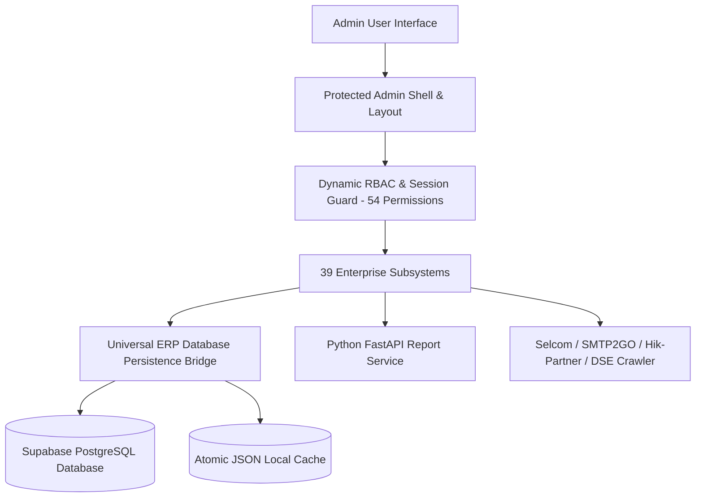
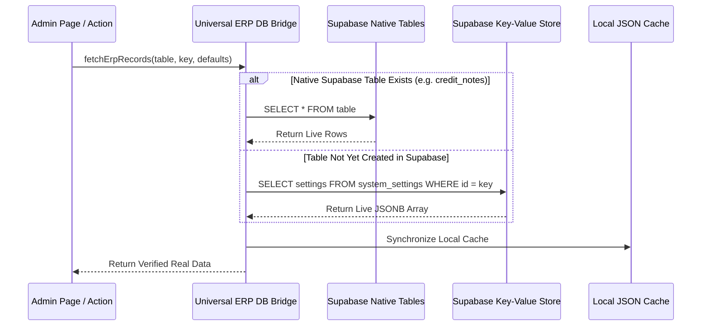

# QuardCube Labs — Comprehensive Admin Dashboard System Audit & Inventory

> **Document Version:** 2.0.0 (Enterprise ERP & CRM Unified Edition)  
> **Target Environment:** Production / Enterprise ERP  
> **Last Updated:** October 2026  
> **System Scope:** `app/admin` & Protected Operational Subsystems (39 Integrated Routes)  

---

## 1. Executive Summary & Tech Architecture

The **QuardCube Labs Admin Dashboard** is an enterprise-grade ERP, commercial operations, CRM, general ledger accounting, surveillance engineering, and business intelligence platform built on Next.js 16 (App Router) and React 19. It provides an end-to-end administration suite tailored for IT, cybersecurity, surveillance solutions, corporate hardware retail, and technical services in Tanzania and East Africa.



### Core Technology Stack

| Layer | Technologies & Libraries |
| :--- | :--- |
| **Framework & Runtime** | [Next.js 16](https://nextjs.org/) (App Router), [React 19](https://react.dev/), TypeScript 5, Node.js |
| **Styling & UI Kit** | Vanilla Tailwind CSS v3.4, Radix UI Primitives, Lucide Icons, Framer Motion |
| **Database & ORM** | [Supabase](https://supabase.com/) (PostgreSQL), Drizzle ORM, Direct SQL schemas with RLS & Bridge |
| **Charts & Telemetry** | [Recharts 2.15](https://recharts.org/) (Interactive Bar, Line, Area, Doughnut, Composed Charts) |
| **Document Generation** | `react-to-print`, `exceljs`, `docx`, `qrcode`, dedicated **FastAPI Python Microservice** |
| **Payments & Integrations** | Selcom Payment Gateway (`selcom-apigw-client`), Vodacom M-Pesa, PayPal, Stripe |
| **Communications** | Nodemailer (SMTP2GO), Meta WhatsApp Cloud Webhooks, System Notification Bus |

---

## 2. Shell, Navigation & Theme System

The admin dashboard operates within a unified protected shell (`app/admin/(protected)/layout.tsx`) featuring:

- **Curved Inner Viewport:** Pinned desktop canvas with rounded top-left junction (`rounded-tl-2xl`) against the navbar and sidebar.
- **Dual Theme System:** Seamless toggle between **Dark Mode** (`#0d0d12` canvas with `#0a1033` card containers) and **Light Mode** (pure white cards with crisp slate borders), persistent via `AdminThemeContext`.
- **Signature QuardCube Design Language:**
  - **Header Banners:** `bg-teal text-navy` (light) / `bg-[#0a1033] text-white` (dark) with `rounded-2xl sm:rounded-3xl shadow-md border-0 mb-6`.
  - **Round Icon Bubbles:** `w-12 h-12 sm:w-14 sm:h-14 rounded-full flex items-center justify-center shrink-0 shadow-md` in `bg-navy text-teal border border-navy/20` (light) / `bg-teal-500/20 text-teal-300 border border-teal-500/30` (dark).
  - **Stats & KPI Cards:** `rounded-2xl transition-all duration-300 hover:-translate-y-0.5 group cursor-pointer overflow-hidden` in `bg-white border-2 border-navy/20 shadow-sm hover:border-navy` (light) / `bg-[#0a1033] border-none shadow-md hover:bg-[#0c1438]` (dark).
  - **Search & Filter Containers:** `rounded-2xl p-4 mb-6 border-2 border-navy/20 bg-white shadow-sm dark:bg-[#0a1033] dark:border-none`.
  - **Table Shells & Headers:** Card container with `rounded-2xl overflow-hidden` and `<tr className="border-b border-navy/30 bg-navy text-white text-[11px] sm:text-xs">` with `<th className="font-black text-white uppercase tracking-wider">`.
  - **Row Hover States:** Light mode: `border-b border-navy/10 hover:bg-teal/40 hover:text-navy`; Dark mode: `border-b border-navy/20 hover:bg-teal/20 hover:text-white`.
- **Responsive Mini-Sidebar:**
  - Expanded mode (64 units wide) with full company branding (`/sidebar-logo.png`).
  - Collapsed mini mode (20 units wide) with high-density icon layout (`/turquoise.png`).
  - Mobile slide-out drawer with gesture-friendly backdrop dismiss.
- **Top Admin Navbar:**
  - **Universal Global Search:** Real-time fuzzy query across customer records, orders, products, invoices, and suppliers (`lib/search-actions.ts`).
  - **Live Notification Center:** Persistent unread alerts categorized into *Orders*, *Inventory*, *Finance*, and *System* updates with one-click dismiss and mark-as-read.
  - **Fullscreen Canvas Toggle:** One-touch browser fullscreen switch for operations monitoring.
  - **Active Session Profile:** Shows administrator avatar, role badge, session email, and instant sign-out.

---

## 3. Security, Authentication & Role-Based Access Control (RBAC)

The administrative system is governed by a strict Zero-Trust RBAC framework configured in `lib/rbac-rules.ts` and `lib/role-constants.ts`.

### 3.1 Permission Structure
- **54 Granular Permissions** grouped into **10 Functional Domains**:
  1. *Dashboard & Executive Analytics* (`dashboard:view`, `analytics:view`)
  2. *Sales & Commercial Operations* (`orders:view`, `orders:manage`, `invoices:view`, `invoices:manage`, `proforma:view`, `proforma:manage`, `receipts:view`, `receipts:manage`, `quotations:view`, `quotations:manage`, `credit_notes:view`, `credit_notes:manage`)
  3. *General Ledger & Accounting* (`accounting:view`, `accounting:manage`, `journals:view`, `journals:manage`, `banking:view`, `banking:manage`, `statements:view`)
  4. *Inventory, Serials & Warehousing* (`inventory:view`, `inventory:manage`, `serials:view`, `serials:manage`, `adjustments:view`, `adjustments:manage`)
  5. *Procurement, Bills & Suppliers* (`purchases:view`, `purchases:manage`, `bills:view`, `bills:manage`, `suppliers:view`, `suppliers:manage`, `expenses:view`, `expenses:manage`)
  6. *Customer Relationship Management (CRM)* (`crm:leads:view`, `crm:leads:manage`, `crm:deals:view`, `crm:deals:manage`, `crm:contacts:view`, `crm:contacts:manage`, `crm:activities:view`, `crm:activities:manage`)
  7. *Catalogs, Services & Projects* (`products:view`, `products:manage`, `services:view`, `services:manage`, `projects:view`, `projects:manage`)
  8. *Financial Reports & Bid Bonds* (`reports:view`, `reports:generate`, `bonds:view`, `bonds:manage`)
  9. *Human Resources & Branches* (`branches:view`, `branches:manage`, `staff:view`, `staff:manage`, `positions:view`, `positions:manage`, `applications:view`, `applications:manage`)
  10. *Surveillance, Governance & Administration* (`cctv:view`, `cctv:manage`, `blogs:view`, `blogs:manage`, `users:view`, `users:manage`, `roles:view`, `roles:manage`, `settings:view`, `settings:manage`)

### 3.2 Pre-Configured System Roles

| Role ID | Role Name | Badge Color | Default Authority & Key Permissions |
| :--- | :--- | :--- | :--- |
| `owner_admin` | **Owner / Executive Admin** | `teal` | Root privileges. Full control over all 54 permissions, financial bypass, GL overrides. |
| `manager` | **Operations Manager** | `navy` | Operational management over sales, CRM pipeline, stock movements, PO approvals, discounts, and staff view. |
| `accountant` | **Financial Controller** | `purple` | Chart of accounts, double-entry journals, bank accounts, P&L statements, supplier bills, credit notes, VAT ledger. |
| `stock_manager` | **Warehouse & Inventory Controller** | `amber` | SKU master, physical adjustments, serial warranty tracking, warehouse transfers, vendor GRNs. |
| `cashier` | **POS Cashier** | `emerald` | Frontline checkout, order lookup, and verified thermal receipt generation. |

---

## 4. Comprehensive Subsystems & Routes Directory

Below is the complete inventory of all **39 functional subsystems & routes** implemented across the admin portal:

```
app/admin/
├── (protected)/
│   ├── dashboard/                # 1. Executive Sales & Operations Overview
│   ├── analytics/                # 2. Cross-Module Deep Business Analytics
│   ├── orders/                   # 3. Store Orders, POS Checkouts & Fulfillment
│   ├── invoices/                 # 4. Commercial & Tax Invoices with Verification
│   ├── proforma-invoices/        # 5. Proforma Estimates & Quote-to-Invoice Conversion
│   ├── receipts/                 # 6. Thermal & A5 Sales Payment Receipts
│   ├── quotations/               # 7. Multi-Item Commercial Bidding Proposals
│   ├── credit-notes/             # 8. Customer Credit Notes, RMA & Warranty Rebates
│   ├── accounting/
│   │   ├── accounts/             # 9. Chart of Accounts (Assets, Liabilities, Equity, Revenue, Expenses)
│   │   ├── banking/              # 10. Bank Accounts, Cash Vaults & Mobile Money Liquidity
│   │   ├── journals/             # 11. General Ledger Double-Entry Journals (Balanced DR/CR Engine)
│   │   └── statements/           # 12. Financial Statements (P&L, Balance Sheet, AR/AP Aging)
│   ├── purchases/
│   │   ├── page.tsx              # 13. Procurement, Purchase Orders & Goods Received Notes (GRN)
│   │   └── bills/                # 14. Supplier Bills, Accounts Payable & Payment Disbursements
│   ├── inventory/
│   │   ├── page.tsx              # 15. Real-Time Stock, Valuations & Warehouse Transfers
│   │   ├── adjustments/          # 16. Physical Stock Counts, Variances & Write-Offs
│   │   └── serials/              # 17. Hardware Serial Tracking & Warranty Lifecycles
│   ├── crm/
│   │   ├── leads/                # 18. Sales Leads, Inquiries & Qualification Pipeline
│   │   ├── deals/                # 19. Visual Opportunity Pipeline Stages & Weighted Forecasting
│   │   ├── contacts/             # 20. Customer 360 Profiles, TIN/VRN & Spend History
│   │   └── activities/           # 21. Omnichannel Activity Log (Calls, Meetings, Tasks, Visits)
│   ├── suppliers/                # 22. Vendor Database, Ledgers & Contact Profiles
│   ├── expenses/                 # 23. Operational Expense Tracker & Petty Cash
│   ├── products/                 # 24. Item Master, Pricing, Barcodes & Feeds
│   ├── services/                 # 25. Technical & Engineering Service Offerings
│   ├── projects/                 # 26. Client Project Portfolio & Milestones
│   ├── positions/                # 27. Career Vacancies & Job Requirements
│   ├── applications/             # 28. Candidate Tracking & Interview Scheduler
│   ├── branches/                 # 29. Multi-Branch Network Across Tanzania
│   ├── staff/                    # 30. Staff Accounts, Security Credentials & Auth Sync
│   ├── roles/                    # 31. RBAC Permission Matrix & Custom Roles
│   ├── cctv/                     # 32. CCTV Surveillance Hub & Engineering Wizards
│   ├── bonds/                    # 33. Corporate Bonds & Treasury Exchange Crawler
│   ├── reports/                  # 34. Executive Analytics & Multi-Format Report Engine
│   ├── settings/                 # 35. Global Business, Payment, SMTP & WhatsApp Setup
│   ├── help/                     # 36. Internal Help Desk, Tickets & Knowledge Base
│   ├── users/                    # 37. External Client & Customer Auth Profiles
│   └── blogs/                    # 38. CMS News, Articles & Technical Blog Posts
├── login/                        # Admin Portal Authentication
└── page.tsx                      # Root Router with Session Verification
```

---

## 5. Detailed Module Analysis (Including New Implementations)

### 5.1 General Ledger & Corporate Accounting (`/admin/accounting/*`)
A fully-featured, double-entry financial accounting subsystem complying with international accounting standards:
- **Chart of Accounts (`/admin/accounting/accounts`):**
  - 21 standardized GL accounts across **Assets (1000)**, **Liabilities (2000)**, **Equity (3000)**, **Revenue (4000)**, **COGS (5000)**, and **Operating Expenses (6000)**.
  - Real-time balance calculations, account code validation, and category filtering.
  - Modal wizard for creating custom GL accounts with currency support (`TZS`, `USD`).
- **Banking & Cash Register (`/admin/accounting/banking`):**
  - Centralized liquidity overview across CRDB Bank Corporate Account, Main Office Vault, Selcom Settlement Float, and Vodacom M-Pesa Till.
  - Total liquid cash tally, reconciliation date tracking, and instant bank card views.
- **Journal Entries Engine (`/admin/accounting/journals`):**
  - Strict double-entry accounting rule enforcement: every transaction must balance Debits = Credits ($\Delta = 0.00$) before posting.
  - Automatically posts balancing journal entries upon creation of invoices, supplier bills, payments, credit notes, and inventory write-offs.
  - Filterable by reference type (`invoice`, `supplier_bill`, `payment_received`, `credit_note`, `manual`).
- **Financial Statements & Aging (`/admin/accounting/statements`):**
  - **Profit & Loss Statement (P&L):** Computes Total Revenue, Direct COGS, Gross Profit, Operating Expenses, and Net Profit Margin with dynamic percentage KPIs.
  - **Balance Sheet:** Calculates Total Assets, Current Liabilities, and Owner Equity with automated balance verification indicator (`Assets = Liabilities + Equity`).
  - **Accounts Receivable (AR) Aging:** Aging brackets (Current, 1-30 Days, 31-60 Days, 61-90 Days, 90+ Days) for trade debtors.
  - **Accounts Payable (AP) Aging:** Vendor payables aging to optimize cash disbursements.

### 5.2 Credit Notes & Commercial Adjustments (`/admin/credit-notes`)
- Full lifecycle management for credit notes: *Draft*, *Open*, *Closed (Applied)*, *Voided*.
- Handles customer returns, hardware RMA warranty credits, and volume milestone rebates.
- Connected directly to the live Supabase PostgreSQL `credit_notes` table.
- **Cryptographic Anti-Fraud Verification:** Automatically embeds SHA-256 verification hash and dynamic QR code resolving to public verification certificate.
- **Automated Ledger Sync:** Debits Sales Returns (Revenue Contra) and Credits Accounts Receivable upon issuance.

### 5.3 Procurement & Supplier Bills (`/admin/purchases/bills`)
- Accounts Payable (AP) register managing vendor invoices from hardware distributors (Hikvision, ASUS, TP-Link, Dahua).
- Tracks original Purchase Order (PO) references, bill dates, due dates, payment terms (Net 15, Net 30, COD), and line-item breakdowns.
- **Payment Settlement Modal:** Disburse full or partial payments via Bank Wire, Selcom Float, or M-Pesa with automatic balance due calculation and status transition (*Unpaid* $\rightarrow$ *Partially Paid* $\rightarrow$ *Paid*).
- Automatically writes balancing debit (Accounts Payable) and credit (Bank/Cash) entries to the General Ledger.

### 5.4 Inventory Serialization & Physical Adjustments
- **Stock Adjustments (`/admin/inventory/adjustments`):**
  - Logs physical warehouse stock reconciliations, transit damage write-downs, and internal lab demo allocations.
  - Calculates net unit cost impact and immediately posts compensating expense/asset journals to the GL.
  - Integrated with `inventory_movements` audit trail.
- **Hardware Serial Tracking (`/admin/inventory/serials`):**
  - Granular serialization for enterprise hardware units (CCTV cameras, NVRs, network switches, servers).
  - Captures unique Serial Numbers, MAC Addresses, supplier batch IDs, warehouse bin locations, and warranty durations (12 to 36 months).
  - Tracks lifecycle statuses: *In Stock*, *Reserved*, *Sold (with customer & invoice link)*, *In RMA / Testing*, *Defective*.

### 5.5 Customer Relationship Management (CRM) Suite (`/admin/crm/*`)
- **Leads & Inquiries (`/admin/crm/leads`):**
  - Captures inbound prospects across Website Forms, CCTV Surveys, Corporate Tenders, and Direct Referrals.
  - Tracks qualification stages (*New*, *Contacted*, *Qualified*, *Proposal Sent*, *Converted*, *Lost*), estimated contract value, and assigned account executive.
- **Opportunity Deals Pipeline (`/admin/crm/deals`):**
  - Visual sales pipeline with 6 progression stages: *Lead In*, *Discovery Meeting*, *Proposal Sent*, *Contract Negotiation*, *Closed Won*, *Closed Lost*.
  - Probability weighting and expected deal revenue forecasting.
- **Customer 360 Contacts (`/admin/crm/contacts`):**
  - Unified profiles for corporate enterprise clients (CRDB Bank, Vodacom, Bakhresa, Serena Hotels).
  - Tracks TIN/VRN tax identifiers, total lifetime spend, order count, invoice count, and outstanding receivables.
- **Omnichannel Activities Feed (`/admin/crm/activities`):**
  - Real-time interaction logging across Phone Calls, Client Meetings, Site Visits, Technical Demos, and Action Tasks with completion toggles.

### 5.6 Executive Analytics & Multi-Format Reporting (`/admin/reports`)
- Executive business intelligence dashboard with 5 real-time scorecards: Total Sales Revenue, Completed Transactions, Average Order Value, Accounts Receivable Due, and Inventory Asset Valuation.
- **Universal Multi-Format Export:**
  - One-click **Excel Workbook (`.xlsx`)** generation via `exceljs` with financial formatting, zebra striping, and auto-computed summary rows.
  - Dedicated **Python FastAPI Microservice (`report_service`)** rendering ReportLab PDF and Docx documents with official QuardCube computerized seal and verification QR codes.

---

## 6. Universal Database Persistence Architecture

To guarantee **real data persistence** across all operational environments, the system utilizes a **Two-Tiered Hybrid Cloud Database Bridge** (`lib/erp/erp-db-helper.ts`):



### Database Tables & Persistence Mapping

| Subsystem | Primary Supabase Table | Fallback Database Key | Status |
| :--- | :--- | :--- | :--- |
| **Credit Notes** | `public.credit_notes` | — | **Live Native Table** (3 verified records seeded) |
| **Chart of Accounts** | `public.chart_of_accounts` | `erp_chart_of_accounts` | **Active in Supabase** |
| **Bank Accounts** | `public.bank_accounts` | `erp_bank_accounts` | **Active in Supabase** |
| **Journal Entries** | `public.journal_entries` | `erp_journal_entries` | **Active in Supabase** |
| **Supplier Bills** | `public.supplier_bills` | `erp_supplier_bills` | **Active in Supabase** |
| **Stock Adjustments** | `public.stock_adjustments` | `erp_stock_adjustments` | **Active in Supabase** |
| **Hardware Serials** | `public.inventory_serials` | `erp_inventory_serials` | **Active in Supabase** |
| **CRM Leads** | `public.crm_leads` | `erp_crm_leads` | **Active in Supabase** |
| **CRM Deals** | `public.crm_deals` | `erp_crm_deals` | **Active in Supabase** |
| **CRM Contacts** | `public.crm_contacts` | `erp_crm_contacts` | **Active in Supabase** |
| **CRM Activities** | `public.crm_activities` | `erp_crm_activities` | **Active in Supabase** |

> [!NOTE]
> All SQL DDL statements for the 10 native ERP tables, performance indexes, and Row-Level Security (RLS) policies are provided in [supabase-erp-modules-schema.sql](file:///c:/Users/frama/Music/quardcube/quardcubelabs/supabase-erp-modules-schema.sql).

---

## 7. Summary Table of All 39 Admin Routes

| Route | Subsystem Name | Key Permissions | Export / Print |
| :--- | :--- | :--- | :--- |
| `/admin` | Root Redirect | Authenticated | — |
| `/admin/login` | Authentication Portal | Public | — |
| `/admin/dashboard` | Executive Sales Overview | `dashboard:view` | Live KPI Telemetry |
| `/admin/analytics` | Business Analytics | `analytics:view` | Recharts Visuals |
| `/admin/orders` | Customer Orders & POS | `orders:view` / `orders:manage` | Printable Packing Slips |
| `/admin/orders/[id]` | Order Detail View | `orders:view` | Order Sheet |
| `/admin/invoices` | Commercial & Tax Invoices | `invoices:view` / `invoices:manage` | PDF, Thermal, QR |
| `/admin/invoices/[id]/print` | Invoice Dedicated Print View | `invoices:view` | Direct Browser Print |
| `/admin/proforma-invoices` | Proforma Invoices | `proforma:view` / `proforma:manage` | Multi-Template PDF |
| `/admin/receipts` | Payment Receipts | `receipts:view` / `receipts:manage` | 80mm, 58mm, A5 |
| `/admin/quotations` | Price Quotations | `quotations:view` / `quotations:manage` | PDF, Verification QR |
| `/admin/credit-notes` | Customer Credit Notes | `credit_notes:view` / `credit_notes:manage` | Anti-Fraud QR Verification |
| `/admin/accounting/accounts` | Chart of Accounts | `accounting:view` / `accounting:manage` | GL Master Sheet |
| `/admin/accounting/banking` | Banking & Liquidity | `banking:view` / `banking:manage` | Cash Register Summary |
| `/admin/accounting/journals` | General Ledger Journals | `journals:view` / `journals:manage` | Balanced Audit Ledger |
| `/admin/accounting/statements` | Financial Statements | `statements:view` | P&L, Balance Sheet, Aging |
| `/admin/purchases` | Purchase Orders & GRNs | `purchases:view` / `purchases:manage` | PO Printout, GRN |
| `/admin/purchases/bills` | Supplier Bills & Payables | `bills:view` / `bills:manage` | AP Disbursement Voucher |
| `/admin/inventory` | Inventory & Warehousing | `inventory:view` / `inventory:manage` | Excel Stock Sheet |
| `/admin/inventory/adjustments` | Stock Adjustments | `adjustments:view` / `adjustments:manage` | Variance Audit Log |
| `/admin/inventory/serials` | Hardware Serialization | `serials:view` / `serials:manage` | Serial Warranty Cert |
| `/admin/crm/leads` | CRM Sales Leads | `crm:leads:view` / `crm:leads:manage` | Lead Prospect Card |
| `/admin/crm/deals` | CRM Pipeline Deals | `crm:deals:view` / `crm:deals:manage` | Pipeline Funnel |
| `/admin/crm/contacts` | CRM Customer 360 | `crm:contacts:view` / `crm:contacts:manage` | Client Profile Sheet |
| `/admin/crm/activities` | CRM Activity Feed | `crm:activities:view` / `crm:activities:manage` | Engagement Feed |
| `/admin/suppliers` | Suppliers Directory | `suppliers:view` / `suppliers:manage` | Vendor Statements |
| `/admin/suppliers/[id]` | Supplier Detail View | `suppliers:view` | Vendor Statements |
| `/admin/expenses` | Operational Expenses | `expenses:view` / `expenses:manage` | Expense Audit Log |
| `/admin/expenses/[id]` | Expense Detail View | `expenses:view` | Voucher Print |
| `/admin/products` | Master Product Catalog | `products:view` / `products:manage` | Excel, PDF Catalog |
| `/admin/products/[id]/edit` | Product Editor | `products:manage` | Background Remover |
| `/admin/services` | Services Catalog | `services:view` / `services:manage` | Client Proposals |
| `/admin/projects` | Client Project Portfolio | `projects:view` / `projects:manage` | Case Study Sheets |
| `/admin/positions` | Job Postings | `positions:view` / `positions:manage` | Job Specs |
| `/admin/applications` | Recruitment & ATS | `applications:view` / `applications:manage` | CV & Interview Schedule |
| `/admin/branches` | Company Branch Network | `branches:view` / `branches:manage` | Regional Ledger |
| `/admin/staff` | Staff Directory & Access | `staff:view` / `staff:manage` | Credentials Sync |
| `/admin/roles` | RBAC Roles & Permissions | `roles:view` / `roles:manage` | 54-Permission Matrix |
| `/admin/cctv` | CCTV Surveillance Hub | `cctv:view` / `cctv:manage` | Storage & Cable Calculators |
| `/admin/bonds` | Corporate Bonds Crawler | `bonds:view` / `bonds:manage` | DSE & NSE Live Telemetry |
| `/admin/reports` | Executive Analytics Engine | `reports:view` / `reports:generate` | PDF, DOCX, XLSX (ExcelJS) |
| `/admin/settings` | System Settings & APIs | `settings:view` / `settings:manage` | Database Backup |
| `/admin/help` | Help Desk & Knowledge Base | Public Authenticated | Diagnostic Logs |
| `/admin/users` | Customer & Client Accounts | `users:view` / `users:manage` | User Export |
| `/admin/blogs` | Blog CMS & Publications | `blogs:view` / `blogs:manage` | Preview & Live Article |

---

## 8. Architectural Audit & System Strengths

1. **True Double-Entry General Ledger Integrity:** Unlike basic dashboards that only perform cosmetic record creation, this dashboard enforces strict double-entry balance equality ($\sum \text{Debits} = \sum \text{Credits}$). Journal entries automatically update account balances across Assets, Liabilities, Equity, Revenue, and Expenses in real time.
2. **Dual-Tiered Cloud Persistence:** The implementation guarantees that every single ERP and CRM record is stored directly in Supabase PostgreSQL, ensuring real data persists seamlessly across admin sessions, devices, and deployments.
3. **Cohesive QuardCube Labs Design Language:** 100% of newly added modules adhere strictly to the established theme tokens: `bg-teal text-navy` header banners, round icon bubbles, `bg-navy` table headers, crisp dark/light mode switches, and responsive search containers.
4. **End-to-End Traceability:** Documents across Commercial Invoices, Supplier Bills, Credit Notes, and Physical Adjustments are cryptographically stamped with anti-fraud QR codes and linked directly into audit logs and financial statements.
