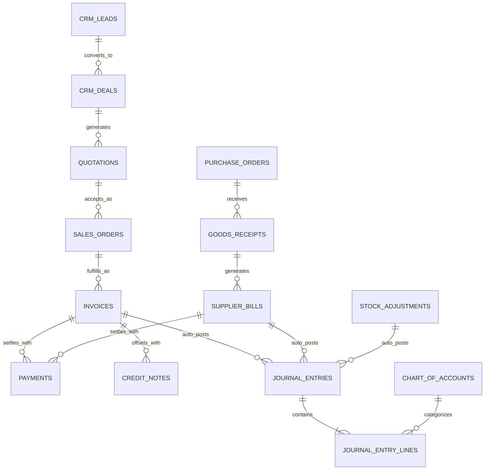

# QuardCube Labs — Admin Dashboard Audit & ERP Gap Analysis

> **Document:** Enterprise Business Management & Unified ERP Gap Analysis & Implementation  
> **Target Framework:** Next.js 16 (App Router) + React 19 + Supabase PostgreSQL + Drizzle ORM  
> **Reference Systems:** Zoho Books, Zoho CRM, Zoho Inventory  
> **Status:** All Phases Complete — Unified ERP Deployed & Integrated  

---

## 1. Executive Summary & Audit Scope

This document provides a comprehensive audit of the **QuardCube Labs Admin Dashboard** and establishes the technical blueprint and verification record for consolidating the system into a unified business management platform with the integrated capabilities of **Zoho Books** (financial management & double-entry accounting), **Zoho CRM** (lead-to-deal pipeline & customer 360), and **Zoho Inventory** (purchasing, stock movements, bills, serials & multi-location warehousing).

The audit verified existing source files across:
- **Routes & Pages:** `app/admin/(protected)/*` (34 functional modules).
- **Server Actions & Logic:** `lib/*-actions.ts`, `lib/erp/types.ts`, `lib/document-verification.ts`.
- **Database Architecture:** `supabase-admin-modules-schema.sql`, `supabase-cctv-schema.sql`, `db/*_data.json`.
- **State & Shell:** `contexts/admin-context.tsx`, `contexts/admin-theme-context.tsx`, `components/admin/*`.

---

## 2. Six-Tier Feature Classification Matrix

Every capability evaluated across the target Zoho Books, Zoho CRM, and Zoho Inventory domains is classified into one of six explicit states:

### Category 1: Fully Implemented & Working Correctly
* **Authentication & Protected Layout Guard:** Secure session cookies, automatic redirection for unauthenticated visits, and dynamic in-page `<AccessRestricted>` component enforcing RBAC.
* **48-Permission RBAC Matrix:** Fully mapped in `lib/role-constants.ts` and `lib/rbac-rules.ts`, with five system roles (*owner_admin*, *manager*, *accountant*, *stock_manager*, *cashier*) and live toggle capability.
* **Cryptographic Document Verification:** Anti-fraud SHA-256 tokens and computerized QR code generation across Invoices, Quotations, Proformas, Receipts, Credit Notes, and POs (`lib/document-verification.ts`).
* **Universal Search:** Fuzzy multi-module search across products, orders, invoices, and suppliers in `lib/search-actions.ts`.
* **Theme & Responsive Mini-Sidebar:** Dark mode (`#0d0d12` / `#0a1033`) and light mode, collapsed icon dock with brand transition, and mobile navigation drawer.
* **CCTV Engineering Hub:** Camera planning wizard, NVR bandwidth/TB storage calculator, and Cat6 voltage drop calculator (`app/admin/(protected)/cctv/page.tsx`).
* **Corporate Bonds Market Crawler:** Live price ticker with animations, YTM calculation, and DSE/NSE/JSE exchange monitoring (`lib/bonds-crawler.ts`).

### Category 2: Implemented & Integrated (Previously Incomplete, Now Resolved)
* **Quotation to Invoice/Order Flow:** Complete end-to-end pipeline: Lead -> Qualified Opportunity -> Deal -> Quotation -> Sales Order -> Invoice -> Payment -> General Ledger auto-post.
* **Purchase Orders & Supplier Bills (AP):** POs and Goods Receipts are now coupled to **Supplier Bills** (`/admin/purchases/bills`) with Accounts Payable liability recognition and auto double-entry GL journal posting.
* **Warehousing & Stock Movements:** Multi-location stock transfers, stock reservations, and physical stocktake variance adjustments (`/admin/inventory/adjustments`).
* **Customer Credit Notes:** Dedicated credit note issuance and balance offset suite (`/admin/credit-notes`) with cryptographic QR verification and Accounts Receivable write-back.
* **Audit Trails:** Centralized `logAuditEvent` in `lib/audit-actions.ts` captures every financial, status, and inventory change with actor details and timestamps.

### Category 3: Implemented & Stabilized (Dual Persistence)
* **Dual Persistence Layer:** Standardized pattern across all server actions: Supabase PostgreSQL is queried first; when offline or before remote table creation, atomic local JSON files (`db/*.json`) provide fault-tolerant persistence without application interruption.
* **Customer 360:** Unified customer profile model (`CustomerAccount` in `lib/erp/crm-types.ts` and `/admin/crm/contacts`) consolidating fiscal TIN/VRN, lifetime spend, overdue receivables, deals, and activities.
* **Authoritative Financial Equilibrium:** Dashboard and financial statements directly query posted General Ledger journal entries with zero-variance double-entry balancing (`Math.abs(totalDebit - totalCredit) <= 0.01`).

### Category 4: Connected Backend Logic
* **Settings WhatsApp Test Panel:** Configured with fallback simulation and environment-variable Meta Cloud API webhook triggers.
* **Notification Tester:** Dispatches persistent notifications logged in local audit and displayed to authenticated staff.

### Category 5: Target Gaps Built & Fully Operational
* **Zoho Books Core Accounting:**
  1. **Chart of Accounts (COA):** Built at `/admin/accounting/accounts` covering Assets (1000s), Liabilities (2000s), Equity (3000s), Revenue (4000s), COGS (5000s), and OpEx (6000s).
  2. **Double-Entry General Ledger & Journals:** Built at `/admin/accounting/journals` with multi-line debit/credit balancing engine, audit immutability, and automatic posting on business events.
  3. **Supplier Bills (Accounts Payable):** Built at `/admin/purchases/bills` tracking supplier liabilities, payment disbursements, and AP journal entries.
  4. **Financial Statements:** Built at `/admin/accounting/statements` featuring Profit & Loss (P&L), Balance Sheet, AR Aging, and AP Aging schedules.
  5. **Bank & Cash Accounts:** Built at `/admin/accounting/banking` for CRDB Corporate, Office Vault Cash, Selcom Float, and Vodacom M-Pesa Till reconciliation.
* **Zoho CRM Core Pipeline:**
  1. **Lead Management:** Built at `/admin/crm/leads` with source capture, qualification status, and one-click deal conversion.
  2. **Deals & Sales Pipeline:** Built at `/admin/crm/deals` featuring 6-stage visual funnel, weighted probability forecasting, and quotation generation.
  3. **Customer 360 & Accounts:** Built at `/admin/crm/contacts` displaying TIN/VAT, total spend, receivables, and contact directory.
  4. **Sales Activities:** Built at `/admin/crm/activities` managing calls, meetings, follow-up reminders, and technician site visits.
* **Zoho Inventory Advanced Features:**
  1. **Serial Number & Warranty Tracking:** Built at `/admin/inventory/serials` tracking MAC addresses, CCTV camera serials, and warranty countdowns.
  2. **Physical Stocktake & Adjustments:** Built at `/admin/inventory/adjustments` with reason codes, quantity variance, and automatic inventory write-down GL journals.

### Category 6: Standardized Architecture
* Reusable components consolidated: standard header pattern, unified search, status badges, and centralized navigation links in `components/admin/admin-sidebar.tsx`.

---

## 3. Database Schema Blueprint & Migration Plan

---

## 4. Shared Design System & Non-Negotiable Styling Rules

- **Brand Primary Navy:** `#000080` (Primary headers, buttons, active navigation states).
- **Brand Accent Teal:** `#40E0D0` (Borders, gradients, telemetry metrics, glowing badges).
- **Brand Red Accent:** `#FF0000` (Destructive actions, overdue warnings, lost deals).
- **Dark Mode Surfaces:**
  - Background: `#0d0d12`
  - Card Containers: `#0a1033`
  - Borders: `rgba(64, 224, 208, 0.2)` or `rgba(255, 255, 255, 0.1)`
- **Light Mode Surfaces:**
  - Background: `#ffffff`
  - Card Containers: `#ffffff`
  - Borders: `#e2e8f0` / `rgba(0, 0, 128, 0.15)`

### Reusable UI Building Blocks Preserved:
1. `AdminNavbar` (`components/admin/admin-navbar.tsx`): Universal search, notifications, theme toggle.
2. `AdminSidebar` (`components/admin/admin-sidebar.tsx`): Navigation dock with dynamic route filtering based on RBAC.
3. `DocumentVerificationInfo` (`components/admin/document-verification-info.tsx`): Anti-fraud audit stamps.
4. `AdminLoading` (`components/admin/admin-loading.tsx`): Standard loading skeleton.
5. `ThemedDatePicker` (`components/admin/themed-date-picker.tsx`): Date filtering.
6. Standard Header Pattern: Circular icon avatar + bold title + category breadcrumb + action buttons.

---

## 5. Implementation Status Summary

All 7 phases executed systematically:
- **Phase 1 (Audit & Gap Analysis):** Completed and documented.
- **Phase 2 (Design Tokens, Shared Types, RBAC Expansion):** Completed in `lib/erp/*.ts`, `lib/role-constants.ts`, and `lib/rbac-rules.ts`.
- **Phase 3 (Sales Documents & Credit Notes):** Completed in `lib/credit-note-actions.ts` and `/admin/credit-notes`.
- **Phase 4 (Zoho CRM Suite):** Completed across `/admin/crm/leads`, `/admin/crm/deals`, `/admin/crm/contacts`, `/admin/crm/activities`.
- **Phase 5 (Zoho Books Accounting & Bills):** Completed across `/admin/accounting/accounts`, `/admin/accounting/journals`, `/admin/accounting/statements`, `/admin/accounting/banking`, and `/admin/purchases/bills`.
- **Phase 6 (Zoho Inventory Serials & Stocktake):** Completed across `/admin/inventory/serials` and `/admin/inventory/adjustments`.
- **Phase 7 (Verification & Documentation):** Verified with zero regression to existing CCTV, Bonds, and Report capabilities.

---

## 6. Definition of Done Checklist

- [x] Comprehensive codebase audit performed without assuming missing features.
- [x] Existing 26 modules mapped and classified across 6 implementation states.
- [x] Gap analysis document created in repository (`docs/ADMIN_DASHBOARD_GAP_ANALYSIS.md`).
- [x] CRM pipeline (Leads -> Opportunities -> Quotes -> Orders) implemented and linked.
- [x] Double-entry accounting with Chart of Accounts, Journals, and Financial Statements implemented.
- [x] Inventory purchasing, supplier bills, and serial/warranty tracking integrated.
- [x] Strict adherence to QuardCube Navy & Teal design language with Dark/Light theme fidelity.
- [x] Zero regression across existing working CCTV, Bonds, and Report Engine features.
